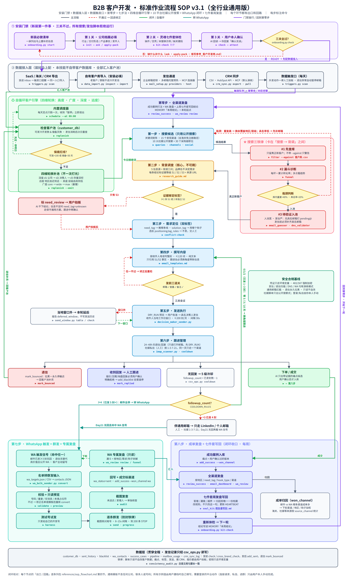

# SOP 逻辑闭环流程图 (v3.1)

> 本文件是 B2B 客户开发全流程的**可视化 if/else 逻辑闭环**，与 SKILL.md 各章节逐条对应。
> 配套图片（通用版，无任何具体公司信息）：`assets/sop_flowchart.png`；矢量/PDF 版：`assets/sop_flowchart.pdf`；
> 机器可读规格 `assets/sop_flowchart.json`（与图同时生成）——`python3 scripts/consistency_audit.py` 第 N 节用它核对
> 步骤名、命令和关键数字是否与 SKILL.md / SOP.md / 本文件 / 脚本常量一致。改图必须同时改这三份。
> 如需在图里补充你公司的 WhatsApp 号码等信息，请用你自己确认过的值重绘，不要写进通用模板。

**v3.1 相对 v3.0 新增**：
- 顶部新增 **② 数据接入层**：自有客户库导入（安装必填声明）· SaaS/海关/CRM 导出导入 · 企业邮箱密钥 / 多邮箱托管预热 / MCP 发信 · CRM 同步 · 数据触发口；全部汇入客户池。
- 自循环引擎改为 **四维轮换**：深度（d1 公司 → d2 决策人 → d3 存量深挖）→ 远度（地区由近到远）→ 高度（层级由高到低）→ 广度（core/wide/max）。
- **数据触发口**（`triggers.py scan`）每天扫客户池与各数据表，发出去的动作一律人工拍板；退信异常自动暂停托管邮箱。

**v3.0 相对 v2.2 新增**：
- 顶部 **① 安装门禁**：新装必做清单 → 公司档案必填 → 灵魂七件套内容体检 → 用户本人确认，三关不过直接回补填（红色虚线），过了才进第零步。
- 第一步 **三类发现源**：关键词矩阵 · 15 个发现渠道（含海关免注册路径）· 10 大社媒免登录公开搜索 + 30 个采购链职位。
- 第二步 **证据分级 S1/S2/S3**：证据不够（只有 S3）→ 标 need_review 交用户拍板，回到第三步。
- 第五步 **收件人当地发信窗口**（脚本强制）：窗口外本轮延后，下一窗口再发。
- 第六步 **两套节奏**：邮件 5 级冷却（3/3/10 天）+ 社媒私信 1-3-7-21（人工），同一天只走一个渠道。
- 第八步 **成单复盘 + 七件套周复盘写回**：归因到唯一一份档案 → kit-check → 回到第零步。

## 图例

| 线条 | 含义 |
|------|------|
| 灰色实线 | 主流程 |
| 红色虚线 | 不通过 → 回退修正 |
| 绿色实线 / 虚线 | 闭环 / 自循环（虚线 = 等待后重试） |
| 青色实线 | 转 WhatsApp |
| 紫色实线 | 门禁放行 / 回到第零步开始下一轮 |
| 黄色菱形 | 判断节点（if / else） |
| 每个节点底部「▶」 | 该步对应的脚本命令或参考文档 |

---

## 一、主流程图

- **① 安装门禁**（`onboarding.py start` → `init / ask / apply-pack` → `kit-check` → `check → attest`）→ `if` 三关任一不过 → 缺什么补什么（红色虚线回新装清单）；`else` READY → 第零步。
- **② 数据接入层**（安装后马上配）：自有客户库 `data_import.py inspect → import`（档案 `data_sources.customer_db` 必填 imported / crm_sync / none）· SaaS/海关/CRM 导出放 `data/inbox/` 走同一入口 · 发信通道 `mail_setup.py`（企业邮箱密钥 / 多邮箱托管预热 / MCP 连接器）· `crm_sync.py`（CSV / HubSpot API / MCP）→ 全部汇入客户池 `customer_db.csv`。
- **数据触发口**（`triggers.py scan`）：池低 / 新导入文件 / 到期跟进 / 新回复 / 退信异常 / WA 线索 / 预热升档 / 邮箱暂停 / CRM 待同步 / 周复盘 → 写 `trigger_queue.json`；`if` 涉及外发 → 人工拍板；`else` 保护性动作（退信异常暂停邮箱）可自动。
- **♻ 自循环引擎**：调度器每日一次 → 检查客户池 → `if` 可发 <100 或储备 <30 天 → 四维轮换补池（深度 d1→d2→d3 · 远度 地区由近到远 · 高度 层级由高到低 · 广度 core→wide→max）→ 今日搜索词进第一步；`else` 充足 → 待明日（绿色虚线）。
- **第零步 全渠道复盘**（`review_success` · `wa_review review`）：成功案例打法 + WA 复盘 + 上周七件套写回结论；MEMORY「本周结论」是本轮起点。
- **第一步 搜索候选**（`queries` · `channels` · `social`）→ 搜索三铁律：#1 先查库（`filter --against`）→ #2 漏斗诊断（`funnel`）→ `if` 瓶颈（库内重复 >40% / 具名率 <20%）→ 换地区/层级或先补邮箱，回第一步（红色虚线）；`else` #3 待验证入池 → 真正新客户进第二步。
- **第二步 背景调查**（5 信息源 + 背调三问 + S1/S2/S3）→ `if` 只有 S3 → need_review，用户拍板后进第三步；`else`（≥1 条 S1 或 2 条独立 S2）→ 第三步。
- **第三步 需求定位**（双标签分流）：need_tag（你自定义的产品/服务线 line_a / line_b / multi / unknown）→ 推哪条线；solution_tag（11 个通用决策驱动）→ 用哪个钩子：compliance/sustainability → 合规型；quality_upgrade/exclusive_custom → 差异型；low_commitment/cost → 低门槛型；speed → 时效型；innovation/one_stop → 新方向型；dedicated_service/strategic_scale → 专属型；open/unknown → 通用探索。违反 `positioning.tag_rules` → 不发，交人工（`conflict-check`）。
- **第四步 撰写内容**：按收件人母语写整封、≤120 词、纯文本、只引用 S1/S2 事实。
- **发前三道关**（邮箱 ✓ 查重 ✓ 备注 ✓）→ `if` 任一不过 → 修正后回第四步重检；`else` → 第五步。
- **第五步 发送执行**（`DRY_RUN=1` 预览 → 用户批准 → `decision_maker_sender.py`）→ `if` 收件人当地不在工作日窗口 → 本轮延后（`deferred_window`），下一窗口再发；`else` 发送并回写。
- **第六步 跟进管理**（`imap_scanner.py`，先 `DRY_RUN=1`；`cooldown`）→ 四分支：
  - 退信 → `mark_bounced` 拉黑 + 永久停触达 → 回客户池补员（绿色）
  - 回复 → `mark_replied` → 人工跟进；报价/交期/询盘回复必须用户确认；明确拒绝 → `add_blacklist` 全渠道停
  - 无回复 → 看 `followup_count`（= 已发封数 − 1）：0 / 1 / 2（已发 1–3 封）→ 分别等 3 / 3 / 10 天 → 换角度回第四步；3（已发 4 封）→ 停通用邮箱 → LinkedIn/个人邮箱（人工 · 1-3-7-21）；≥4（已发 5 封及以上）→ 邮件全停 → 第七步 WhatsApp
  - 成交 → 第八步
- **第七步 WhatsApp 触发**：触发信号 → `convert` → `validate → preview`（不过 → 修正后重新 convert）→ `harness` 测试号 → `send`（到 200 条 STOP，次日 `progress` 续发）→ `audit` → 回写 + `--won_channel wa` → `wa_review` → 汇入第八步，并反哺下一轮 WA 名单。
- **第八步 成单复盘 + 七件套写回**：`add_success`（用户确认的痛点）→ 全渠道复盘（`review_success` · `email_dashboard` · `wa_review --compare-email`）→ 七件套周复盘写回（`soul_kit/周复盘写回.md`）→ `kit-check` → 回到第零步开始下一轮（紫色）。

---

## 二、WhatsApp 群发子流程 —— 邮件→WA 闭环的最后一环

> 通用版不内置含真实号码的子流程图，避免泄露联系方式。文字版流程如下
>（对应 `scripts/wa_bulk/` 与 `wa_bulk_guide.md`，号码一律取建档确认值）：

导出 `wa_targets` → 套模板校验（号码用 `<phone-E164>` 占位直到你填自己的号）
→ 逐个开聊天 + 未注册号白屏检测 → 截图核对尾号 → 发送并回写 `won_channel`
→ `wa_review` 渠道复盘 → 触发下一轮，形成闭环。

- **入口**:主流程转来的 pending 名单(wa_targets.json)。
- **双号铁律**:小号(开发号)= 登录群发(被封只损开发号);大号(客户对接号)= 签名/对接,**绝不群发**。
- **① 名单转输入**(wa_bulk_sender.py convert wa_targets.json):pending → Format B 模板 + 变量,phone/brand/intro 由 need_tag/背调生成差异化。
- **validate 校验** → `if` 号码格式/非空消息不通过 → 修正名单/模板重新 convert(红虚线);`else` 进预览。
- **② preview 预览(只读,不发送)** → `if` 有重复/雷同消息或含 wa.me 链接 → 重写 {intro}、删除 wa.me(群发禁 wa.me,判营销即封)(红虚线);`else` 全差异化进 harness。
- **③ harness 试发自测**(试发给小号)→ `if` 收不到/乱码 → 查 whatsapp:// 协议、清理注册表键(先备份 HKCU\SOFTWARE\Classes\whatsapp)(红虚线);`else` 可正式发。
- **每日额度门槛**:`if` 今日已发 ≥ 200 条 → 停发,次日 progress 断点续发;`else` 进发送循环。
- **单人发送循环(核心 if/else)**:
  1. ④ 取下一个联系人,Start-Process whatsapp://send?phone={phone},等 5 秒
  2. **popup 白屏检测**:屏幕中心 3×3 采样 9 点,`if` ≥6 白(未注册)→ SKIP 记录 checkpoint;`else` 进截图验证
  3. **截图验证**:去非数字比对尾 8 位,`if` 匹配当前联系人 → 发送;`else` 重试(最多 2 次)→ 仍失败 SKIP
  4. ⑤ 发送:剪贴板临时文件粘贴 + SendKeys 回车(避免特殊字符损坏)
  5. ⑥ Checkpoint:更新 wa_progress.json + 日计数(崩溃可断点续发)
  6. **防封节流**:本条间隔 8-15s 随机,每 5 条冷却 30-60s
  7. `if` 名单还有未发联系人 → 回额度检查(蓝色循环回路);`else` 全部处理完进 audit
- **收尾**:⑦ audit 逐个截图复查 → `if` 有异常(未送达/发错人)→ 单独补发/核查;`else` ⑧ 回写 wa_status="sent",下次看板归入「✅ 已转WA」→ 回主流程看板追踪。

---

## 三、关键设计原则(讲解要点)

1. **每一个淘汰/停止都有明确 if 条件**,不靠感觉:竞品、撞发、退信、通用邮箱、未注册号、雷同消息,全部前置判断。
2. **失败必回退,不硬闯**:三道关、WA 三道自检门,任一不过都回退修正,而非跳过。
3. **闭环可循环**:退信补池、跟进递进回扫描、群发断点续发,数据始终回写,支撑下一批循环。
4. **wa.me 语境澄清**:群发禁 wa.me(判营销即封);但看板「一键调用」是你手动点开单个聊天,安全合理 —— 两者不矛盾。
5. **双号隔离风险**:群发只用小号,大号永不群发,把封号损失锁定在开发号。

---

## 四、闭环核对表（每个节点的出口与回路）

> 判定标准：每个节点都必须同时有 **正常出口**（去哪）和 **异常/循环回路**（不通过或等待时回哪）。表中任何一格为空，就算闭环没做完。

| 节点 | 正常出口 | 异常 / 循环回路 | 由谁保证 |
|---|---|---|---|
| 新装必做清单 | 第 1 关 | — （入口） | `onboarding.py start` |
| 第 1 关 公司档案 | 第 2 关 | 缺必填 → 回补填（ask / apply-pack） | `config.missing_fields`，脚本门禁 |
| 第 2 关 七件套体检 | 第 3 关 | 缺件/空壳/示例未替换/缺关键段 → 回补填 | `config.kit_health` / `kit-check` |
| 第 3 关 用户确认 | 第零步 | 未确认或改过档案 → `user_confirmed` 重置 → 回 check | `attest`（拒绝占位符/未体检） |
| 数据接入层 · 客户库导入 | 客户池 `customer_db.csv` | 列没识别 → `--map` 指定后重导；老客户/禁联 → 不进冷开发池 | `data_import.py` |
| 数据接入层 · 发信通道 | 第五步可真发 | `test` 登录失败 → 换客户端密钥 / 开协议；邮箱暂停 → 排查后 `resume` | `mail_setup.py` |
| 数据接入层 · CRM 同步 | CRM 与客户库一致 | 回拉只更新已有邮箱；推送默认 DRY_RUN | `crm_sync.py` |
| 数据触发口 | 按队列进对应步骤 | 外发动作 → 人工拍板；处理完 `ack`；次日再扫 | `triggers.py` |
| 调度器 / 检查客户池 | 四维补池 → 第一步 | 充足 → 待明日；退信补员 → 回检查客户池 | `schedule` / `replenish` |
| 第零步 全渠道复盘 | 第一步 | 无成功案例 → 直接第一步（仍读 MEMORY 结论） | `review_success` |
| 第一步 搜索候选 | #1 先查库 | 瓶颈 → 换地区/层级或补邮箱 → 回第一步 | `filter --against` / `funnel` |
| #3 待验证入池 | 第二步 | 无具名邮箱 → pending@ 占位，发信前必须补齐 | `email_guesser` / `dns_validator` |
| 第二步 背景调查 | 第三步 | 只有 S3 → need_review → 用户拍板后回第三步 | research_guide 五·五 |
| 第三步 需求定位 | 第四步 | 违反 tag_rules → 不发，交人工 | `conflict-check` |
| 第四步 撰写内容 | 发前三道关 | 跟进轮次从冷却回到这里（换角度） | email_templates |
| 发前三道关 | 第五步 | 任一不过 → 修正后回第四步 | `check` / `cross_brand_check` / 占位符拦截 |
| 第五步 发送执行 | 第六步 | 当地窗口外 → 延后到下一窗口；到每日上限或预热上限 → 次日；退信超阈值 → 邮箱自动暂停 | `send_window.py` / `DAILY_LIMIT` / `mail_setup.py` |
| 第六步 跟进管理 | 四分支 | 无回复 → 冷却后回第四步 | `imap_scanner.py` / `cooldown` |
| 退信 | 回客户池补员 | — （永久停触达） | `mark_bounced` |
| 回复 | 人工跟进 → 成交或拒绝 | 拒绝 → `add_blacklist` 全渠道停 | `mark_replied` |
| 停通用邮箱（已发 4 封） | LinkedIn / 个人邮箱（人工） | Day21 无回且命中 WA 信号 → 第七步 | 社媒 1-3-7-21 |
| 第七步 WhatsApp 触发 | 回写 + `wa_review` → 第八步 | 校验不过 → 重新 convert；到 200 条 STOP → 次日；下轮名单反哺 | `wa_bulk_sender.py` |
| 第八步 成单复盘 + 七件套写回 | 七件套写回 → kit-check | 体检不过 → 回对应档案重写 | `add_success` / `kit-check` |
| 重新体检 | 回第零步（下一轮） | — | 紫色回边 |

自动核对：`python3 scripts/consistency_audit.py` 会检查命令、参数、字段、数量、冷却规则、状态值、社媒平台清单在脚本与文档之间是否一致。
