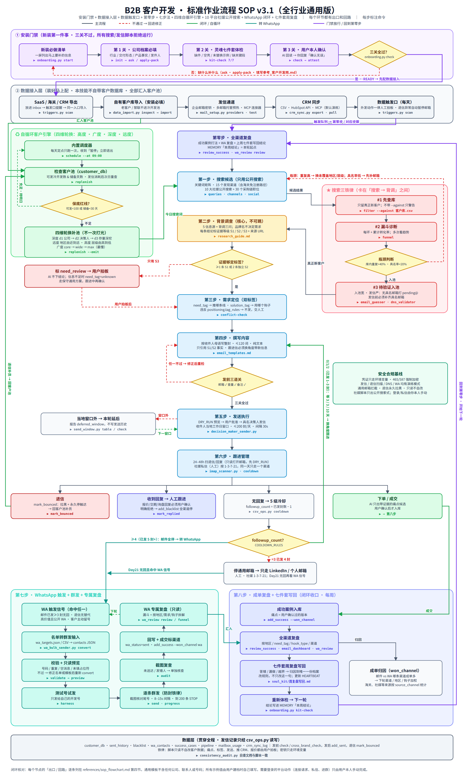

# B2B 客户开发闭环 Skill（全行业通用版）· 中文版

> 本目录是中文版（v3.1）。英文版在仓库根目录：[../README.md](../README.md)。两版结构相同、版本号一致，可任选其一独立使用。

[](LICENSE)
[](CHANGELOG.md)
[](#安装)
[](references/skill_self_check_report.md)

一套行业无关、已脱敏的 B2B 客户开发 Agent Skill：**安装门禁 → 数据接入层 → 第零步复盘 → 七步法 → WhatsApp 触发 → 成单复盘与写回**，每个环节都有出口和回路，每个对外动作都要人拍板。

包内不含任何公司、联系人或客户数据。客户库、邮箱、CRM 都在安装时由使用者自己接入。



## 能做什么

| 环节 | 做法 | 入口 |
|---|---|---|
| 安装门禁 | 公司档案必填 → 灵魂七件套内容体检 → 本人确认并记录内容指纹；三关不过，搜索/发信脚本拒绝运行 | `scripts/onboarding.py start` |
| 数据接入层 | 自有客户库 / SaaS·海关·CRM 导出统一导入；企业邮箱密钥、多邮箱托管预热、MCP 连接器三种发信路径；CRM 同步；每日数据触发口 | `data_import.py` · `mail_setup.py` · `crm_sync.py` · `triggers.py` |
| 自循环引擎 | 四维轮换补池：深度（公司 → 决策人 → 存量深挖）· 远度（由近到远）· 高度（由高到低）· 广度（core → wide → max） | `search_customers.py replenish` |
| 第一步 搜索 | 15 个发现渠道 + 10 大社媒公开搜索式 + 30 个采购链职位；需要登录的动作一律人工 | `search_customers.py queries / channels / social` |
| 第二步 背调 | 证据分级 S1/S2/S3，≥1 条 S1 或 2 条独立 S2 才能打标签；品牌名不决定需求 | `references/research_guide.md` |
| 第三步 定位 | 需求标签 + 方案标签双标签，规则冲突拦截 | `search_customers.py conflict-check` |
| 第四步 撰写 | 收件人母语、≤120 词、纯文本、只引用 S1/S2 事实 | `references/email_templates.md` |
| 第五步 发送 | 演练 → 人工批准 → 只发具名决策人 → 当地窗口 → 限额 → 自动退订头 | `decision_maker_sender.py` · `batch_sender.py` |
| 第六步 跟进 | 冷却期 3/3/10 天最多 4 封，社媒 1-3-7-21，退信永久拉黑 | `imap_scanner.py` · `csv_ops.py cooldown` |
| 第七步 WhatsApp | 触发式启动；校验 → 测试号 → 逐条发 → 200 条强制停 → 截图复查 | `wa_bulk_sender.py` |
| 第八步 复盘 | 成单归因、全渠道复盘、七件套周写回 | `review_success` · `wa_review` |

## 安装

```bash
git clone https://github.com/JanefurZhou/b2b-customer-dev-kit.git
cd b2b-customer-dev-kit/zh
python3 scripts/onboarding.py start        # 看新装必做清单
python3 scripts/onboarding.py init         # 生成空白公司档案
# 填 config/company_profile.json 与 soul_seven_kit/，然后：
python3 scripts/onboarding.py kit-check
python3 scripts/onboarding.py check        # → READY
python3 scripts/data_import.py inspect <你的客户表.xlsx>
python3 scripts/mail_setup.py providers    # 企业邮箱配置路径
python3 scripts/consistency_audit.py       # 包内一致性自查
```

只依赖 Python 3.10+ 标准库。SMTP/IMAP/CRM 密钥只走环境变量，不进任何文件。

## 目录

```
SKILL.md                 Skill 入口与契约
CHANGELOG.md             版本记录
scripts/                 全部脚本（标准库，零第三方依赖）
references/              SOP、搜索详细流程、邮件模板、社媒打法、邮箱配置、SaaS 对接、触发口、流程图
examples/                空白档案与数据模板、三个示例行业档案
docs/training/           培训材料：完整版解说、20 分钟精简版、口语化讲稿、PPT 大纲
```

## 培训材料

`docs/training/` 下有四份配合流程图使用的讲解材料，适合给团队或新人讲这套逻辑。

## 质量

- 包内一致性自查 `scripts/consistency_audit.py`：A–O 15 个维度，脚本与文档术语逐项比对。
- 外部审计 [Skill-Self-Check](https://github.com/xenos2025/Skill-Self-Check)：硬门禁 pass，发布安全静态扫描通过；结论见 `references/skill_self_check_report.md`，逐文件安全审查见 `references/ship_safety_review.md`。

## 边界

- 只用公开搜索和免注册路径；平台登录、连接请求、私信、进群由使用者本人手动完成。
- 不自带客户数据库；不保证成单率；所有数字规则来自包内 SOP，预热档位等为可调默认值。
- 文中引用的第三方服务参数均附官方出处，见 `references/mail_setup.md` 与 `references/外贸SaaS对接指引.md`。

## License

[CC BY-NC 4.0](LICENSE)：可署名后非商业性地使用、修改和分享；商业使用请先联系作者。

## 编码说明

全部文件为 UTF-8。脚本启动时将输出强制为 UTF-8，CSV 写出带 BOM，中文 Windows 下用 Excel 双击打开、或把输出重定向到文件，都不会乱码。文档以中文为主，邮件模板、搜索式和部分字段名为英文。
